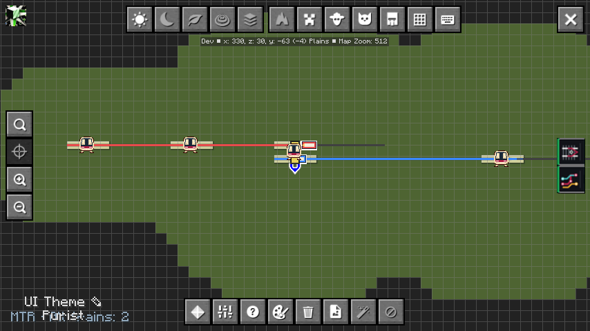
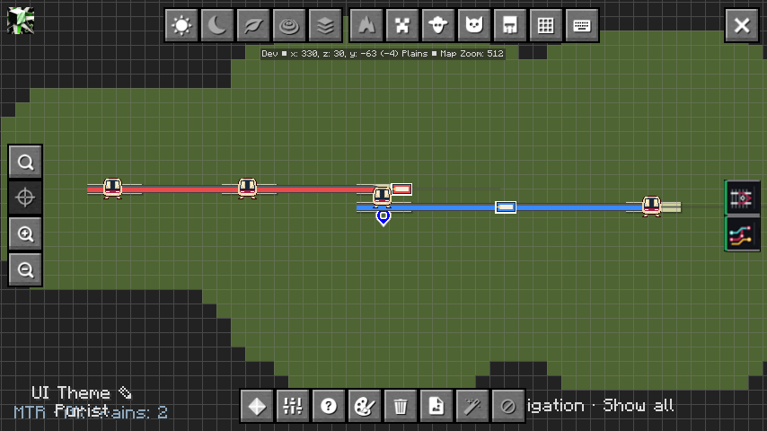
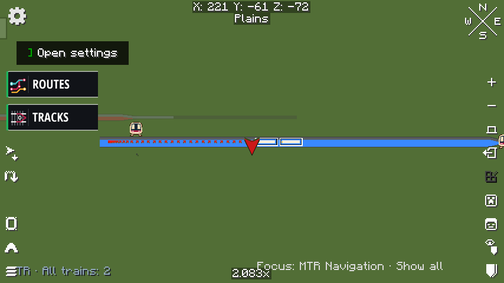
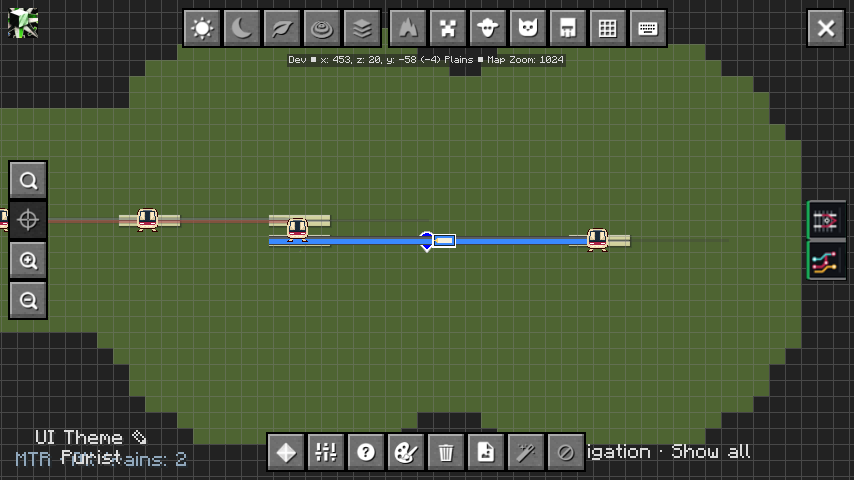
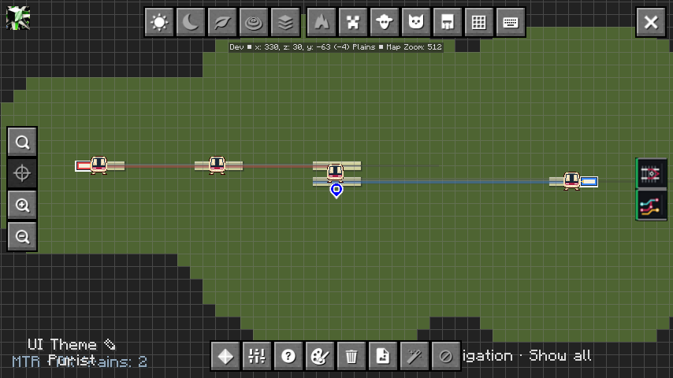

# 导航线网样式验证

2026-11-03，Asia/Taipei。参考用户提供的地图效果，重点调整选中行程与背景线网的视觉层次；Navigation 版本仍为 `0.1.0-alpha.1`，兼容现有 Overlay 1.5.3 公共 API。

| 图层 | 显示 |
| --- | --- |
| 当前与后续乘车区间 | 原线路色、实线、2.25倍线宽、100%不透明度 |
| 已完成乘车区间 | 原线路色、实线、1.2倍线宽、35%不透明度 |
| 无关线网 | 中性灰 `#98A2AF`、实线、0.75倍线宽、30%不透明度 |
| 车站 | 只保留所选停靠序号范围内的沿途车站；换乘站去重 |

不修改基础地图配色或全局 Overlay 设置。取消导航后关闭自身视图，恢复原来的完整线网。高铁等线路在导航时统一为实线，避免白色分段干扰行程识别；列车位置保持原有显示。重复／共享轨道仍由未完成区间覆盖已完成样式，避免将后续要坐的区间提前淡化。

当前 API 只支持车站过滤，不能定制站点符号。因此仍使用 Overlay 原有车站图标，尚未实现参考图里的空心圆点、大号换乘圆点、起终点专用符号；也没有将人工步行连接伪装成轨道。

## 验证

NeoForge 和 Fabric 构建通过；两个目标 MTR Core 的回归各125项，122通过、3按配置跳过、0失败。新增检查中性背景与局部原色覆盖、实际组合线宽、统一实线、完成段样式以及重复站台的精确站点过滤。测试继续使用正式 Overlay 1.5.3 JAR 内的解析器和视图注册器。

在 `NavRideQa3-20261103` 的真实双列车单人线网重新进行 CLI 上车、中途停靠、换乘和终点下车测试。实际渲染调色板及逐阶段结果见 [样式证据](navigation-style-evidence.json)。实机范围为 NeoForge 21.1.249、MTR 4.1.0-beta.2、Overlay 1.5.3；Fabric 仅构建和 Core 回归，不标记客户端视觉通过。

完整流程181秒通过，121次乘车状态采样中不可靠次数为0。另用取消导航／重新查询选择的真实视图补录同视角对比；这组预览是另一个行程，不混入完整实乘结果。

普通全网：

选择行程后：

换乘并登上第二列车后，第一段缩细淡化、第二段继续原色加粗：

最终下车，两段均转为已完成样式：

截图均来自原始 Minecraft framebuffer。当前测试世界是小型运营线网，不能替代密集大网的标记避让验收。此前的[实乘报告](runtime-ride-2026-11-03.md)记录旧样式的15%原色背景，作为历史保留；本页描述新的30%灰色背景。
