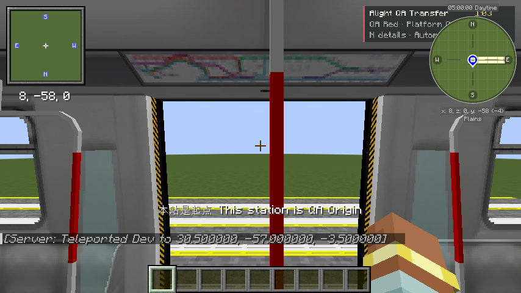
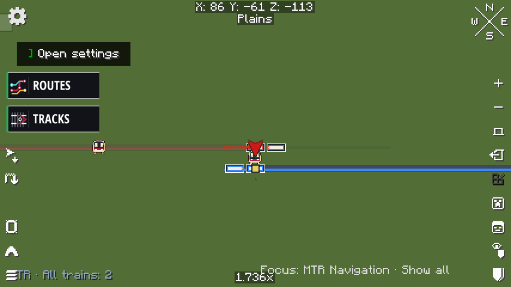
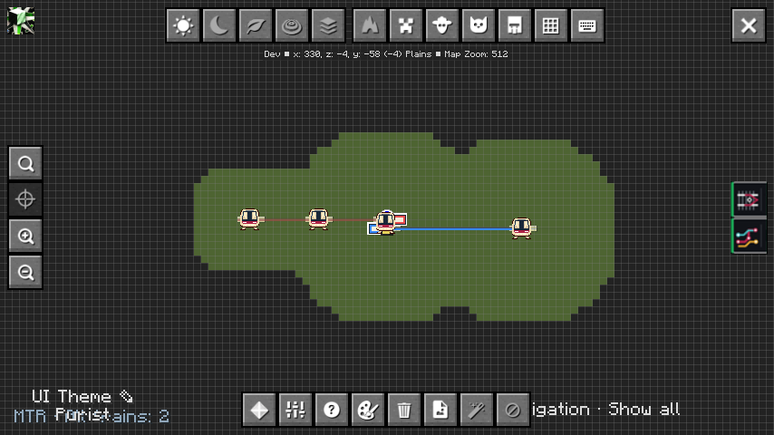
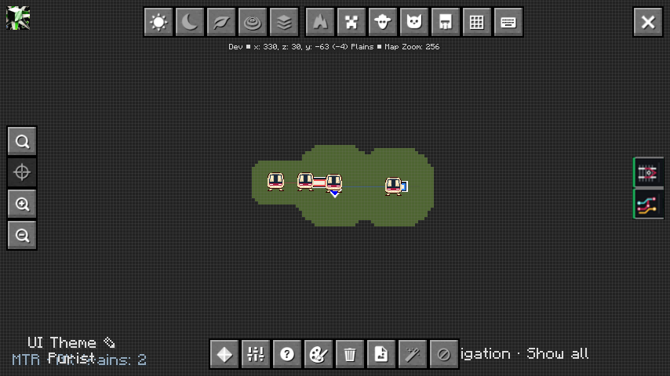

# 单人真实列车与 Overlay 自动淡化验证

2026-11-03，Asia/Taipei。测试分支 `feat/overlay-navigation`，Navigation 内部版本保持 `0.1.0-alpha.1`。本页对应 fork 开发包，不代表上游 Alpha 附件已经更新。

## 环境和真实线网

实际启动 Java Minecraft **1.21.1 / NeoForge 21.1.249 / Java 21.0.11** 的集成单人服务器。加载发布版 MTR **4.1.0-beta.2**、Overlay **1.5.3**、Xaero World Map **1.45.0** 与 JourneyMap **6.0.8**。

新建的存档为 `run/saves/NavRideQa3-20261103`，没有覆盖此前用户操作的 `NavTest`。MTR 原生 `Simulator`、Rail、Station、Platform、Route、Depot 和 Siding 生成了4站、5站台、4个方向线路、2个车辆段、2条存车线和10条轨道；两个 Depot 寻路均返回 SUCCESSFUL。真实车辆采用发布包内已核对的 `m_train_small_cab_1` 和 `m_train_small_cab_2` 资源，每列两节车厢。

- 红线：QA Origin → QA Middle → QA Transfer。
- 蓝线：QA Transfer 的另一站台 → QA Destination。
- 两条线路分别有真实列车和回程运营，必须下车换另一列；没有将一列贯通车当成换乘。

CLI 仅用于定位到实际车门、输入前进／Shift、查询并选择方案、打开地图和保存 Minecraft framebuffer 截图。车门碰撞、乘客更新包、服务端 `VehicleRidingEntity`、车辆运动、到发数据及行程推进均走真实 MTR／Navigation 逻辑。站间没有传送或快进时钟；站内候车位置用单人命令定位，不将此测试当作步行道路可达性验收。脚本不调用 `JourneyTracker.correct()`，也不写乘客集合、导航阶段或 Overlay 样式。

测试桥接、只读乘车包探针和 HTTP 服务仅在 `-PruntimeQa` 下作为独立开发 mod 启用，监听 localhost:18761；普通发行 JAR 不包含 QA 类、Mixin 或控制端口。

## 原生进度和实际渲染检查

最终结果与原生身份记录见 [evidence.json](runtime-ride-evidence.json)。脚本约每秒采样，直接读取实际 Overlay `ViewRenderer.data` 的调色板，不以“请求提交成功”代替透明度检查。

最终严格流程用时 **209.89秒**，197次状态采样中含109次 RIDING，乘车身份不可靠次数为 **0**；两次原生上车、一次中途停站、两次到站下车、换乘步行与 COMPLETE 均通过断言。

| 场景 | 检查 |
| --- | --- |
| 开始导航／候车 | 红线与蓝线100%，未使用方向15% |
| 实际走进第一列车 | 服务端乘客 UUID、车辆、Siding 与完整 RunKey 匹配；自动进入 RIDING |
| 中途站停靠 | 仍为第一乘车段，不误下车；行程区间仍100% |
| 换乘站到站／Shift下车 | 原生开门停靠识别 alight_now；乘客离车后自动进入换乘步行，红线35%、蓝线100% |
| 实际走进第二列车 | 无手动“下一步”，原生匹配后自动结束换乘步行并进入第二乘车段 |
| 终点到站／下车 | 自动 COMPLETE，原生乘客记录清除；两段均35%、其他线路15% |
| 双地图 | 用实际地图按键及滚轮打开 Xaero/JourneyMap，地图不暂停单人模拟；保存原始游戏截图 |

真实车厢内：



换乘后的红线淡化、蓝线保持：




全部下车完成：



## 实乘发现并修复的问题

1. **终点时刻缺失**：MTR 的 Arrivals 回调会省略合并换线站及无限循环的部分终点。现在使用同一原生 Trip 的 stopTimes，或紧邻后继 Trip 中相同终点的原生停靠，按已有原生到发锚点恢复精确时刻。身份和完整停站序列不符时不补全，不运行距离估算或新模拟，不重复加 deviation。
2. **运行中的停靠序号**：Core 的 `platformIndexInRoute` 是当前区间起点序号，下一站事件需要其后一个停靠。现已对应正确出现位置，保留重复站台的序号语义。
3. **终点提前换线**：Core 在尚未开门的终点进站阶段清空或提前切换线路。已通过真实上车确认的班次，若原生乘客仍在同一车辆，且处于相同班次块／紧邻循环和原生终点时间窗口内，保留乘车身份；实际开门停靠才识别到站。离开窗口、换了车辆或目录修订仍不可信，不能自动猜选另一班。
4. **换乘步行不结束**：当服务端可靠确认玩家登上计划的下一列真实列车时，自动进入下一乘车段；单凭距离或计时仍不推进。

测试驱动也修正了两点：使用4.1实际存在的车辆资源 ID；定位车门后输入真实移动，因为 MTR 在站着不动的纯传送情况下不会立即发送乘客更新。这些属于测试控制修正，未修改 MTR 的乘车实现。

## 自动构建与边界

NeoForge 构建、Fabric 构建与两个目标 MTR Core 的测试均通过。每个核心任务 **123项：120通过、3按配置跳过、0失败**；跳过的是两个显式生成器和旧 Overlay 1.5.2 可选兼容项。新增回归检查原生终点时刻、共享终点、偏差只计算一次、顺序不匹配拒绝、重复停台的 native ordinal、真实下一班结束步行、终点元数据变化及不同车辆／过期班次拒绝。

生产 JAR 检查不包含 QA 控制代码、MTR 类或 Overlay API 类。没有改版本号、发布正式 release 或修改 Overlay 仓库。

**实机范围是 NeoForge 单人、两地图、这套双列车换乘线网。** Fabric 做了构建与真实 Fabric Core 回归，未把它标记为客户端实乘通过；多人、大网、复杂环线实乘和站外步行通行性不在本次验收中。原生客户端兼容模式仍缺完整车辆身份，继续需要手动确认。

## CLI 复现

先准备 JDK21，运行 `python tools/download_dependencies.py`，并在 `run/mods` 放入对应 NeoForge 的上述 MTR、Overlay 和地图模组。新建存档名必须未使用：

```powershell
python tools/create_test_world.py NavRideQa-repro
.\gradlew.bat test --tests '*RuntimeRideFixtureTest' -PgenerateFixture "-PfixtureRoot=run/saves/NavRideQa-repro/mtr"
.\gradlew.bat runClient -PruntimeQa -Pquickplay=NavRideQa-repro
```

客户端进入单人存档后，在另一个终端运行：

```powershell
python tools/java_mc_cli.py state
python tools/runtime_ride_scenario.py --prepare
```

`--prepare` 先核对只有四个 QA 车站，建立真实站台方块、通过现有查询服务选择方案。随后按实际时刻候车和乘坐，通常需要数分钟；最长窗口650秒，不加速原生模拟。`build/runtime-ride/` 保留完整 CLI JSONL、逐阶段原生状态、实际渲染调色板、原始 PNG、控制台日志和 `scenario-result.json`。

可用 `python tools/java_mc_cli.py quit` 正常关闭测试客户端；开发桥接没有写进生产包。
